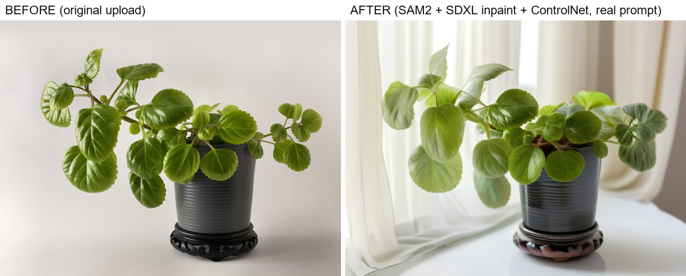
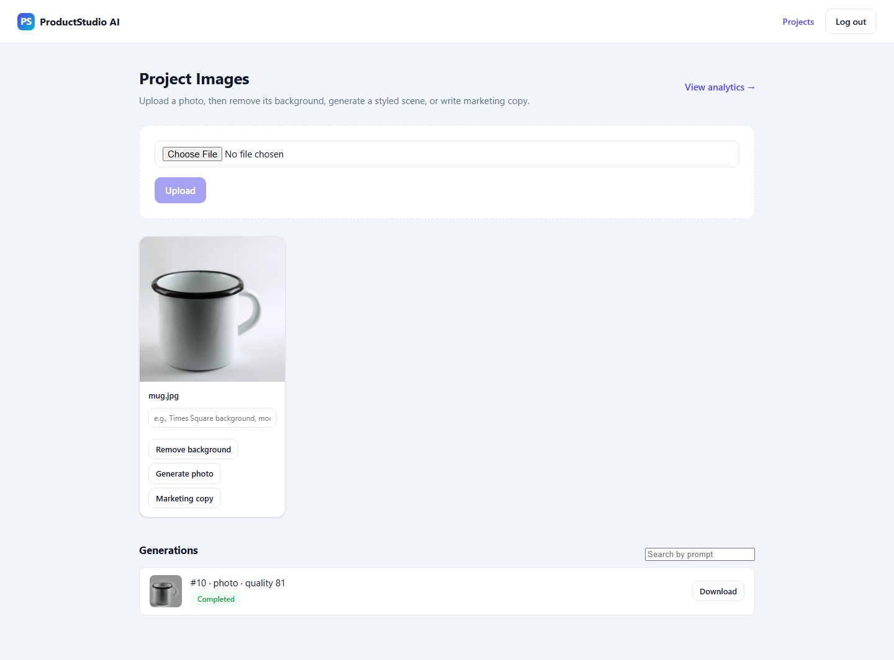

# ProductStudio AI

**Generative Product Photography Platform** — segments product photos and regenerates studio backgrounds via diffusion models, hitting **0.74 median IoU**, **0.98 product SSIM**, and **29.1 CLIP score** on real product photos.



## Results

Measured on a Tesla T4 GPU against 17 real product photos with hand-labelled segmentation ground truth and real text prompts.

| Metric | Result | What it measures |
|---|---|---|
| Segmentation IoU (median) | **0.74** | SAM2 mask accuracy vs. hand-labelled ground truth, 17 real product photos |
| Product SSIM | **0.98** | product preserved unchanged while the background regenerates |
| CLIP score | **29.1** | text-prompt alignment of the generated background |
| Product LPIPS | **0.04** | perceptual distortion on the product region (near zero) |
| Generation latency | **24.5 s/image** | SDXL inpaint + ControlNet, Tesla T4, warm |

## Architecture

```
                      ┌──────────────────────┐
                      │   React Frontend      │  (Vite + TS, JWT auth)
                      └──────────┬────────────┘
                                 │ REST (JSON)
                      ┌──────────▼────────────┐
                      │   FastAPI Backend      │  service layer / repository pattern
                      │  auth, projects, images│
                      │  generations, marketing│
                      │  analytics             │
                      └───┬───────────┬────────┘
                          │           │
              ┌───────────▼──┐   ┌────▼─────────┐
              │  PostgreSQL   │   │    Redis      │  async job queue
              └───────────────┘   └───┬───────────┘
                                       │ enqueues
                                ┌──────▼───────────┐
                                │   Worker            │  process_generation job:
                                │  (backend image)   │  enhance + assess quality
                                └──────┬─────────────┘
                                       │ HTTP
                                ┌──────▼───────────────┐
                                │   AI Inference Service │  separate microservice,
                                │   (GPU box)            │  SAM2 + SDXL / ControlNet
                                └────────────────────────┘
```

The AI inference service is a separate deployable from the backend, talked to over plain HTTP — it can be scaled or moved to any GPU host without touching API code.

## Key Features

1. Upload one or more product photos into a project.
2. Segment the product foreground with **SAM2** (Meta's Segment Anything Model 2) to get a clean, transparent cutout.
3. Regenerate the background from a text prompt with **SDXL inpainting + ControlNet**: the SAM2 mask is the inpaint mask so the product region is never repainted, Canny-edge ControlNet conditioning keeps the diffusion from hallucinating structure across the product silhouette, and the product pixels are composited back from the original so they stay pixel-faithful.
4. Every generated photo automatically runs through an **OpenCV enhancement pipeline** (white balance, CLAHE lighting/contrast correction, sharpening) and is scored across 7 quality dimensions (sharpness, lighting, contrast, resolution, background cleanliness, product visibility, composition).
5. Generate marketing copy (title, description, feature bullets, social caption, SEO keywords) from the product image and metadata.
6. Track generation history, quality trends, and storage usage on a per-project analytics dashboard, and bulk-download finished assets as a zip.



## Design Decisions & Trade-offs

- **SAM2 point-prompting over automatic mask generation.** An unattended upload has no user click, so a centre-weighted point prompt (plus corner background points) stands in for one. It's fast and accurate for the common case — a roughly centred product — but it's a real, known limitation on off-center or portrait-style compositions; see Challenges.
- **Inpainting, not text-to-image, for background generation.** An earlier text-to-image + ControlNet approach regenerated the whole frame and could not guarantee the product stayed untouched. Switching to SDXL *inpainting* with the SAM2 mask as the inpaint mask, plus a final feathered pixel-composite from the original, makes product preservation a property of the pipeline rather than something the model has to get right.
- **A separate AI microservice over a monolith.** SAM2/SDXL need a GPU and heavy Python ML dependencies; the backend doesn't. Splitting them means the backend can run (and its 43 tests can run) with zero GPU, and the inference service can be scaled or swapped independently.
- **A `mock`/`real` pipeline mode switch.** Local development and CI need to boot and test the full request path without a GPU. A placeholder pipeline behind the same interface as the real one keeps the API contract identical in both modes.
- **Evaluation on Colab, not the dev laptop.** SDXL needs ~10-12GB VRAM; the local GPU has 4GB. Rather than skip evaluation or estimate numbers, every metric below was measured on a free Colab T4 GPU — see Benchmarks.

## Challenges

**Hardest bug: a memory optimization that made things worse, silently.** To fit SDXL on a free-tier GPU, the pipeline first used `enable_model_cpu_offload()`, which keeps most model weights in system RAM and streams them to the GPU per layer. Generation began dying with no exception, no traceback, and no log line — it simply vanished mid-request. Root cause, found by watching `nvidia-smi` alongside system RAM during a run: the free tier has *more* GPU VRAM than system RAM (16GB vs. ~12GB), so an optimization meant to relieve VRAM pressure was instead exhausting the smaller of the two resources, and the OS was hard-killing the process before it could raise or log anything. Fix: load the pipeline straight onto the GPU (`pipe.to("cuda")`) instead of offloading, since the T4's VRAM comfortably fits SDXL + ControlNet in fp16 — removing the bottleneck instead of trading it for a worse one.

**Runner-up:** hand-corrected ground-truth mask PNGs occasionally came back rotated 90° relative to their source photo (an image editor silently applying EXIF orientation the source photo didn't carry), which crashed the IoU/boundary-F1 scorer on a raw shape mismatch. Fixed by detecting the transposed-shape case and rotating (not resizing/stretching) to realign, with a warning — a resize would have silently produced a wrong score instead of failing loudly.

## Tech Stack

**AI / ML:** Meta SAM2 (Segment Anything Model 2), Stable Diffusion XL inpainting, ControlNet (Canny-edge conditioning), PyTorch, HuggingFace `diffusers`, HuggingFace `transformers`, CLIP (image-text alignment scoring), LPIPS (perceptual similarity), SSIM, OpenCV

**Backend:** Python, FastAPI, Pydantic, SQLAlchemy, Alembic, PostgreSQL, Redis, JWT auth, REST API design, microservice architecture

**Frontend:** React, TypeScript, Vite

**Infra / Tooling:** Docker, Docker Compose, pytest, Vitest, GPU inference (CUDA), Google Colab (cloud GPU), Git

## Getting Started

```bash
cp .env.example .env
docker compose up --build
```

Backend: http://localhost:8001 (Swagger UI at `/docs`). Frontend: http://localhost:5174.

See [DEPLOYMENT.md](DEPLOYMENT.md) for the full deployment guide.

## Testing

- **Backend:** `cd backend && pytest -v` — 43 tests covering auth, project/image/generation CRUD and ownership enforcement, the OpenCV enhancement and quality-assessment services, the async worker job, marketing content generation, asset downloads, analytics, and one full end-to-end integration test.
- **AI service:** `cd ai-service && pytest -v` — 15 tests covering the segmentation and generation pipelines.
- **Frontend:** `cd frontend && npm run test` — Vitest + React Testing Library, covering auth-gated routing.

**58/58 tests passing.**

## Benchmarks / Evaluation methodology

All numbers above come from one run against 17 real product photos (a plant pot and a headphones shot were excluded from the segmentation metric specifically because their ground truth itself was unreliable — see Challenges), on a Tesla T4 GPU (Google Colab, free tier):

- **Segmentation IoU** — SAM2 (`sam2.1_hiera_large`) generates a mask per image from a centre-weighted point prompt; compared pixel-for-pixel against a hand-labelled ground-truth mask (bootstrapped with GrabCut, then manually corrected) via intersection-over-union.
- **CLIP score** — `openai/clip-vit-base-patch32` (via HuggingFace `transformers`) embeds the generated image and its text prompt; score is `100 × cosine similarity`.
- **Product SSIM / LPIPS** — computed only over the product region (per the SAM2 mask), comparing the original crop against the same region in the generated output. SSIM is a from-scratch `scipy`-based windowed implementation; LPIPS uses an AlexNet backbone.
- **Latency** — wall-clock seconds for SAM2 segmentation + SDXL inpainting (25 steps, 1024px, Canny ControlNet) per image, warm (first-request GPU/model warm-up excluded).

## Future Work

- Full request-to-response latency (upload → queue → GPU inference → download) has not been benchmarked end to end — it requires a continuously-hosted GPU box rather than an on-demand Colab session. The SDXL generation latency itself (24.5s/image) is measured and reported above.
- Expand the hand-labelled evaluation set beyond 17 images for tighter confidence intervals on the IoU/CLIP/SSIM numbers.
- Add a mask-confidence fallback (e.g. a secondary, lower-frame-weighted point prompt) for the known SAM2 point-prompting weak spot on off-center or portrait-style compositions.
- Depth-conditioned ControlNet as an alternative to Canny for scenes where edge conditioning over-constrains the generated background.
